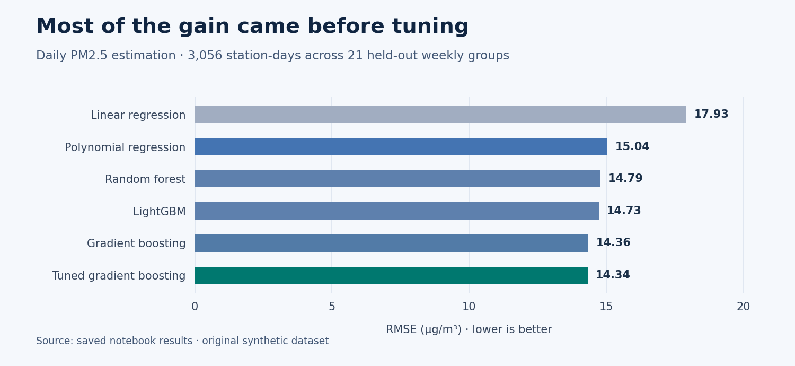

# Air Quality India | PM2.5 Regression

**How well can we estimate daily PM2.5 at a monitoring station using measurements from the same day?** I worked through this as a regression project, starting with the raw records, checking what the data was actually doing, and comparing 16 model configurations on the same held-out weeks.

[Open the original Jupyter notebook](Air%20Quality%20India%20-%20Regression.ipynb) · [Download the original CSV](air_quality_india.csv)

> **Data note:** The supplied dataset is synthetic. It was generated to resemble daily air-quality monitoring records and to include realistic data problems. It contains no official station measurements.

## What changed the result

The strongest result in the saved notebook was **R² 0.9646, RMSE 14.34 µg/m³, and MAE 7.81 µg/m³**. Adding quadratic terms and interactions for just six features cut RMSE from **17.93 to 15.04**. Tuning gradient boosting moved it from **14.36 to 14.34**. Most of the observed gain came from allowing nonlinear relationships, and the leading tree models finished close together.

| Model | Test R² | Test RMSE (µg/m³) | Test MAE (µg/m³) |
|---|---:|---:|---:|
| Linear regression | 0.9446 | 17.93 | 9.64 |
| Polynomial regression, degree 2 on six features | 0.9610 | 15.04 | 8.45 |
| Random forest | 0.9623 | 14.79 | 8.08 |
| LightGBM | 0.9626 | 14.73 | 7.89 |
| Gradient boosting | 0.9645 | 14.36 | 7.82 |
| Tuned gradient boosting | **0.9646** | **14.34** | **7.81** |

The complete comparison is under **Final Results** in the notebook. It includes OLS, Ridge, Lasso, ElasticNet, SVR, bagging, voting, stacking and XGBoost.

## How I worked through it

1. **Check what a row means.** The CSV has 17,600 rows and 35 columns, covering 24 stations across eight cities from November 2024 to October 2026. I found 76 exact duplicates and four more after making the two date formats consistent. After the checks on pollutant readings and the target, 15,741 usable station-days remained.
2. **Investigate extreme readings before dropping them.** Two stations had CO medians hundreds of times larger than the others. The shift affected the whole station, so I divided those CO readings by 1,000. I kept plausible pollution spikes, removed 11 rows with inconsistent PM2.5 and PM10 readings, and marked nine suspect NO₂ readings as missing while keeping the rest of those rows.
3. **Find where the blanks come from.** Seven stations had no benzene or toluene readings. That changed how I thought about imputation. I kept station identity and used an iterative imputer to estimate missing predictors from the available features. Values filled for a station with no sensor are model estimates.
4. **Choose a test that covers the seasons.** Random row sampling would mix records from the same date across training and test. A simple cutoff at June 2026 would leave the winter peak out of the test. I held out 21 weekly groups, which gave **12,685 training rows and 3,056 test rows**. All 12 months are represented in the test, and no dates are shared. The task estimates PM2.5 on held-out dates at known stations.
5. **Keep feature choices readable.** I removed AQI and its category because their calculation uses PM2.5. I encoded day of year with sine and cosine so December and January stay close, one-hot encoded station IDs, and used correlation and VIF to decide which overlapping inputs to drop. The final model matrix has 50 columns.

## What the scores can tell us

PM10 and visibility account for about **98% of the untuned gradient boosting model’s impurity-based feature importance**. PM2.5 is part of PM10, so the high score depends heavily on having a closely related same-day measurement. A comparison with and without PM10 would show how much the other inputs contribute. The notebook reports the experiment with PM10.

The outer test weeks are separate from the fits for imputation and scaling. In the saved notebook, those transformations are fitted before grouped cross-validation, so the inner tuning score can benefit from preprocessing that saw its validation rows. Refitting those steps inside each fold would give a cleaner model-selection estimate. The held-out results describe this synthetic dataset and the stations already represented in training.

## Run it locally

Use **Python 3.10** with the package versions in [requirements.txt](requirements.txt). The original notebook uses older pandas syntax, including `Series.dt.week`, so use the pinned environment for this version.

~~~powershell
python -m venv .venv
.venv\Scripts\Activate.ps1
python -m pip install -r requirements.txt
python -m jupyter notebook "Air Quality India - Regression.ipynb"
~~~

Run the cells in order. Keep `air_quality_india.csv` next to the notebook so the original relative path resolves. The notebook includes saved results, so you can also read through the work without fitting the models again.
